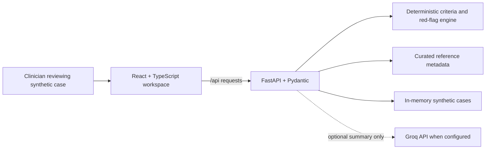

# NEUROSCOPE AI

**See the clues. Connect the evidence.**

NEUROSCOPE AI is a research and demonstration prototype for helping healthcare professionals organize evolving neurological cases, view a chronological timeline, review potential red flags, inspect linked literature, and identify unresolved questions. Autoimmune encephalitis is the primary example, with synthetic infectious and other neurological mimics.

## Problem and approach

Early neurological presentations can evolve while initial investigations are inconclusive. This prototype brings documented symptoms, examination findings, investigations, and pending questions into one chronological review, so a qualified clinician can inspect how the evidence changes over time. It does not determine a diagnosis or replace specialist assessment.

> **Clinical safety:** This prototype is not clinically validated and must not be used to diagnose, rule out disease, prescribe or change treatment, or replace qualified medical judgment. Use fictional synthetic data only. Do not enter personal health information.

## What the demo includes

- Responsive React workspace with a 3D procedural brain illustration, dashboard, structured case form, editable timeline, rules-based review, and evidence explorer.
- Three fictional demonstration cases and a small curated reference list.
- Deterministic Python criteria and red-flag logic. An optional Groq integration can rewrite the case summary; it does not alter the criteria engine. If enabled, case text is sent to Groq. Never enable it for real patient data.
- Browser-only fallback behavior when the API is unavailable. Cases are held in memory and are lost when the server restarts; they are not a database.
- No user accounts, access controls, audit logging, or clinical validation.

### 3D illustration limitation

The hero uses a Three.js procedural, brain-inspired 3D illustration. It is not a licensed anatomical scan or clinically accurate brain model. The source does not use a GLB/GLTF model, and the illustration must not be described as realistic medical anatomy.

## Technology

- Frontend: React, TypeScript, Vite, Three.js, React Three Fiber
- Backend: FastAPI, Pydantic, optional Groq chat completion
- Storage: process memory only; synthetic demo cases are initialized at startup

## Architecture



The UI can use its bundled synthetic fallback examples when the API is offline. The backend provides the same-origin API and, for the Docker/Cloud Run build, serves the compiled frontend. No patient database or account system is implemented.

## Repository layout

```text
backend/                 FastAPI routes, clinical rules, demo cases, reference metadata
frontend/src/            React screens, API client, Three.js brain illustration
Dockerfile               Single-container Cloud Run deployment
test_suite.py            Read-only smoke checks plus synthetic timeline sorting check
```

## Local setup

Prerequisites: Node.js 22+ and Python 3.10+.

### 1. Install backend dependencies

PowerShell:

```powershell
cd backend
Copy-Item .env.example .env
python -m venv .venv
.\.venv\Scripts\Activate.ps1
python -m pip install -r requirements.txt
python -m uvicorn main:app --host 127.0.0.1 --port 8000 --reload
```

The `.env` copy is optional; the placeholder Groq key keeps the deterministic-only mode. Keep real keys out of source control. API health: `http://127.0.0.1:8000/api/health`; OpenAPI: `http://127.0.0.1:8000/docs`.

### 2. Install and run the frontend

In a second terminal, from the repository root:

```powershell
cd frontend
npm ci
npm run dev -- --host 127.0.0.1 --port 5173
```

Open `http://127.0.0.1:5173/`. Vite proxies `/api` to the local FastAPI server. To use the optional Groq summary, set `GROQ_API_KEY` in `backend/.env`; requests include the case text sent for summary generation.

### Environment variables

See [`backend/.env.example`](backend/.env.example) and [`frontend/.env.example`](frontend/.env.example). `CORS_ORIGINS` is a comma-separated allowlist for separate local frontend origins. A same-origin Cloud Run deployment does not need cross-origin access. Set `VITE_API_BASE_URL` only when the frontend and API are hosted separately.

## API overview

| Method | Path | Purpose |
|---|---|---|
| GET | `/api/health` | API and optional LLM status |
| GET | `/api/cases` | List in-memory demo cases |
| GET | `/api/cases/{id}` | Retrieve a case |
| POST | `/api/cases` | Save/update a case in process memory |
| POST | `/api/cases/{id}/timeline` | Replace and sort timeline events |
| POST | `/api/analyze` | Run deterministic criteria and optional summary |
| GET | `/api/evidence` | List curated reference metadata |
| GET | `/api/evidence/search?q=...` | Search reference titles and summaries |

Saved data is not durable. Do not use this deployment for real clinical records.

## Verification

From the repository root:

```powershell
cd frontend
npm run lint
npm run build
cd ..
python -m unittest discover -s backend -p "test_*.py" -v
python test_suite.py
```

The unit tests use FastAPI's in-process test client and only synthetic data. The separate live smoke suite expects the frontend at `http://127.0.0.1:5173` and API at `http://127.0.0.1:8000/api`; override with `NEUROSCOPE_FRONTEND_URL` and `NEUROSCOPE_API_URL`. It checks the health, case list, analysis, evidence, and timeline sorting endpoints.

## Deploy to Google Cloud Run

The repository root `Dockerfile` builds the frontend and serves it with FastAPI from one container, so the published Cloud Run URL serves both the app and `/api`. This is the deployment path to use when a submission form specifically requests a Cloud Run URL. No service has been deployed from this workspace, and no public URL exists yet.

1. Install and authenticate the Google Cloud CLI, select a project with billing enabled, and enable Cloud Run and Cloud Build APIs.
2. From the repository root, replace `REGION` with a region enabled in your project:

```powershell
gcloud run deploy neuroscope-ai --source . --region REGION --allow-unauthenticated --port 8080
```

3. Wait for deployment to finish, then open the service URL printed by `gcloud`. Confirm the home page loads and `<service-url>/api/health` reports `healthy`. Add that actual URL to the submission form only after validating it.
4. Leave the Groq key unset for deterministic-only operation. If you configure it, add it through Cloud Run's secret/environment configuration and use synthetic data only.

Deployment references: [Cloud Run deploy from source](https://cloud.google.com/run/docs/deploying-source-code) · [Cloud Run pricing](https://cloud.google.com/run/pricing). This repository does not currently have a deployed application URL; add one here only after an actual deployment has been verified.

### Optional: deploy frontend and API separately to Vercel

Vercel deployments use two projects for this repository: set the frontend project root to `frontend` (Vite build command `npm run build`, output `dist`) and the API project root to `backend` (FastAPI entry point `main.py`). Deploy the frontend first to obtain its origin. In the backend project's environment, set `CORS_ORIGINS` to that exact frontend origin, then deploy the API. Finally set the frontend's build-time `VITE_API_BASE_URL` to `https://<api-domain>/api` and redeploy the frontend. Keep preview origins separately scoped if previews need API access; do not use `*` for credentialed or private deployments. Confirm the frontend and `/api/health` endpoint after deployment.

References: [Vercel Python runtime](https://vercel.com/docs/functions/runtimes/python) · [Deploying with the Vercel CLI](https://vercel.com/docs/cli/deploying-from-cli). Vercel functions have ephemeral in-memory state, so saved cases are not durable and separate instances may not share updates. Use this path for the synthetic demo only until persistent storage and access controls exist.

Before external use, configure persistence, authentication and authorization, privacy controls, monitoring, security review, clinical validation, and the applicable regulatory process. They are not implemented here.

## Submission checklist

- [ ] Choose the exact challenge shown in the active submission form; it is not inferred by this repository.
- [ ] Deploy with the Cloud Run command above and verify the returned URL and `/api/health`.
- [ ] Enter the actual Cloud Run URL in the requested URL field. Hosting-provider acceptance beyond that field wording has not been confirmed.
- [ ] Capture genuine screenshots from the deployed app; no screenshot assets are included yet.
- [ ] Review all text and sample data; keep the demo synthetic and its limitations visible.
- [ ] Submit the form yourself. This repository work does not submit or publish anything.

The [official PromptWars event page](https://hack2skill.com/event/promptwars2) currently displays registration closed. That page does not establish whether a separate project submission form remains open; check the form owner for the current deadline and challenge selection.

## LinkedIn draft

> I built **NEUROSCOPE AI**, a research and demonstration prototype exploring how an evolving neurological case can be organized into a timeline, reviewed for potential red flags, and connected to medical references and unresolved questions.
>
> The demo uses fully synthetic cases and deterministic criteria logic, with an optional AI-assisted summary. It is not clinically validated and does not diagnose, rule out disease, or recommend treatment. The brain graphic is a procedural 3D illustration rather than an anatomical model.
>
> Built with React, TypeScript, Three.js, FastAPI, and Pydantic. [Add the verified Cloud Run URL after deployment.] #PromptWars #HealthcareAI #ClinicalDecisionSupport

